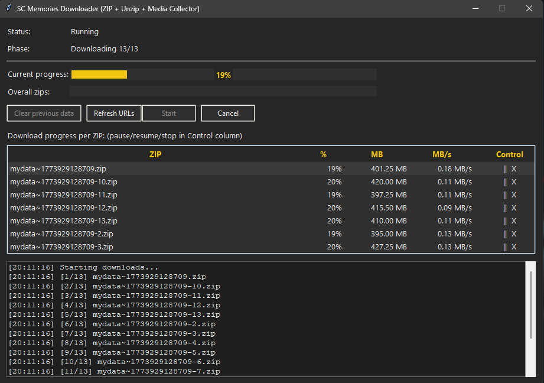

# SC Memories Downloader

Desktop app for Snapchat “Download My Data” exports. It opens the export page, collects the signed `mydata~*.zip` links, downloads the ZIPs, extracts them, and copies images and videos into one flat `media/` folder.



## Requirements

- Python 3.x
- Playwright and Chromium, for refreshing export URLs
- PyInstaller, only if you are building the Windows EXE

```powershell
pip install -r requirements.txt
python -m playwright install chromium
```

`requirements.txt` lists `playwright` and `pyinstaller`. The build script installs Pillow itself when `icon.png` is present.

## Run

By default the app opens a browser on `https://accounts.snapchat.com/v2/download-my-data` and waits until it can see the export ZIP links. Log in there (MFA and captcha included). It tries Microsoft Edge first, then Chromium.

```powershell
python .\Downloader.py
```

If you already have `urls.txt` and do not want a browser session:

```powershell
python .\Downloader.py --skip-fetch-urls --urls-file .\urls.txt
```

`Downloader.py` only calls `sc_memories_downloader.main`.

### Flags

| Flag | Default | What it does |
| --- | --- | --- |
| `--skip-fetch-urls` | off | Skip Playwright and load `urls.txt` |
| `--urls-file` | `urls.txt` | File to read, and to write when `--write-urls-file` is set. Relative paths are next to the EXE, or next to the repo root when you run the script |
| `--write-urls-file` | off | Save the scraped signed URLs into that file |
| `--min-urls` | `5` | How many ZIP links to wait for while scraping |
| `--timeout-sec` | `300` | How long to wait for those links |
| `--fetch-urls` | — | Deprecated. Refresh already happens unless you pass `--skip-fetch-urls` |

`urls.txt` is one URL per line. Blank lines and lines starting with `#` are ignored.

If the startup scrape fails, the window still opens and loads `urls.txt` when that file exists. Use **Refresh URLs** to log in again.

## Window

- **Start** downloads every ZIP in parallel, then unzips them one at a time and copies media into `media/`.
- **Cancel** stops the run.
- **Refresh URLs** runs the browser login again.
- **Flatten media folder** moves files out of any subfolders under `media/` and deletes the empty directories. Use this for a `media/` folder left by an older run.
- **Clear previous data** deletes `downloads/`, `extracted/`, and `media/` after a confirmation. It does nothing while a run is in progress.

The ZIP list shows percent, megabytes, and MB/s. The Control column is not a real button: the left half pauses or resumes that ZIP, the right half stops that ZIP only.

Partial downloads are `downloads/<zipname>.zip.part`. The next run sends an HTTP `Range` request from that file size and appends. The part file is matched by ZIP filename, so a new signed URL for the same export still resumes. If the server ignores `Range` and returns the full file, the download starts over.

Name clashes in `media/` become `name_2.ext`, `name_3.ext`, and so on. A file is skipped when `media/` already has the same name and the same size. Copied types are jpg, jpeg, png, gif, bmp, webp, tif, tiff, heic, heif, svg, mp4, mov, mkv, avi, wmv, webm, mpeg, mpg, m4v, 3gp, and 3gpp.

## Folders

Created next to the EXE, or next to the repo root when you run `python .\Downloader.py`:

- `downloads/` — ZIP files, plus `*.part` while a download is in progress
- `extracted/` — unzipped export contents
- `media/` — images and videos, with no subfolders

## Signed URLs

The repo does not ship export links. They are scraped at runtime. `--write-urls-file` is the only switch that writes them to disk, and `urls.txt` is in `.gitignore`, along with `downloads/`, `extracted/`, `media/`, and `*.part`.

Those links are signed and identify your export. Leave `--write-urls-file` off unless you need the file. Do not commit `urls.txt`. Playwright login state is not saved; `.gitignore` also blocks `*auth_state*.json` and storage-state files if that is added later.

## Windows EXE

```powershell
.\build_windows_exe.ps1 -Clean
```

The script installs `requirements.txt`, installs Playwright Chromium, and runs PyInstaller (`--onefile --windowed`). Output goes to `dist/`.

When `icon.png` exists, it installs Pillow, runs `scripts/generate_icon_set.py`, and passes `assets/icons/app-icon.ico` to PyInstaller. If `%LOCALAPPDATA%\ms-playwright` exists, those browsers are bundled so the EXE can refresh URLs without a separate `playwright install` on the machine that runs it.

Pushing to `main` or `master` runs `.github/workflows/build-windows-exe.yml`, which bumps `.github/build-version.txt` and publishes x64 and x86 builds.
