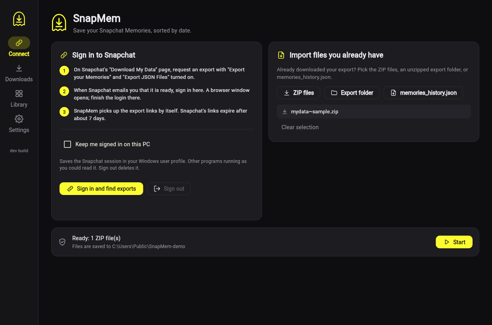
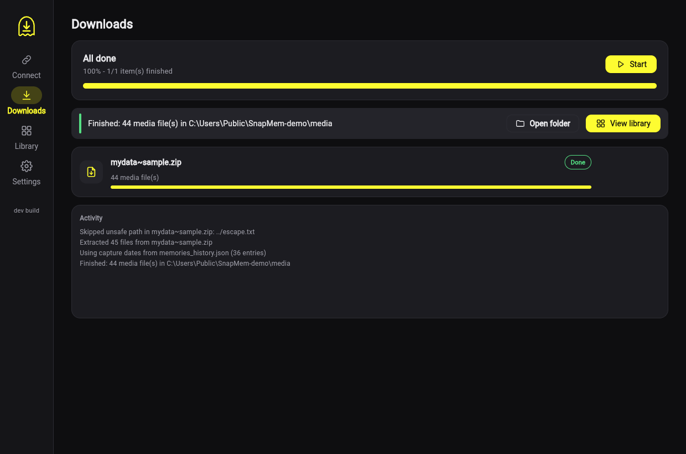
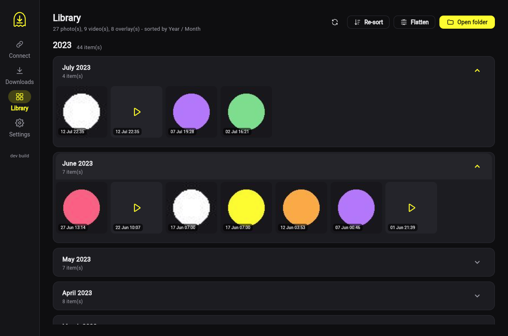
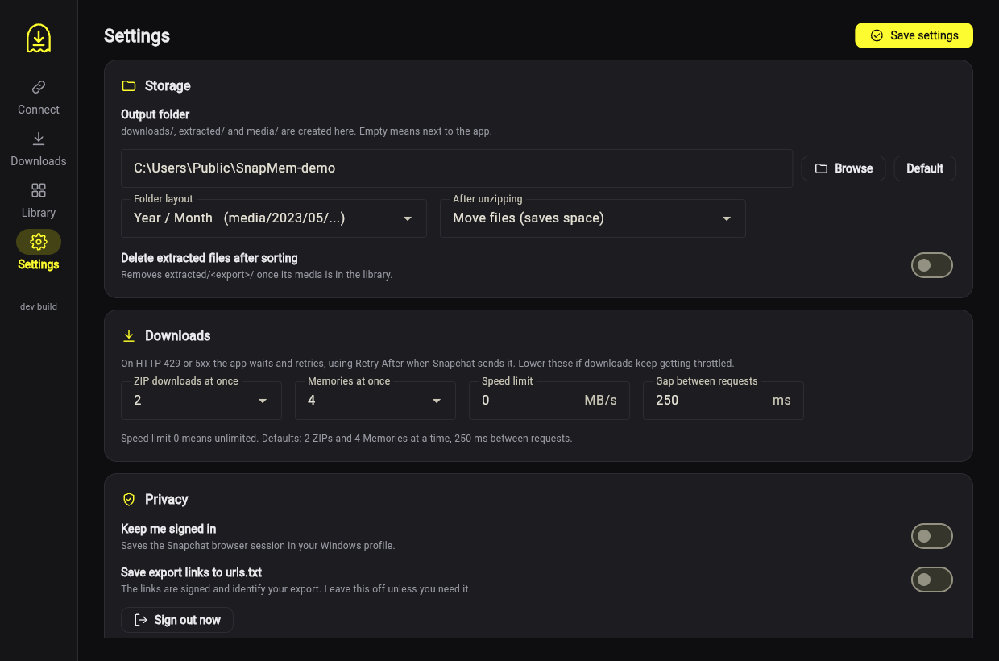

# SnapMem

Desktop app for Snapchat "Download My Data" exports. It gets your export either by signing in to Snapchat or by importing files you already downloaded, then downloads, unzips and sorts every Memory into dated folders.



## Requirements

- Python 3.11 or newer (CI runs 3.11 and 3.12)
- Windows for the packaged EXE; the Python app also runs on Linux and macOS

```powershell
pip install -r requirements.txt
python -m playwright install chromium
```

`requirements.txt` pins Flet 1.0.4 (UI), Playwright (sign-in) and Pillow (EXIF dates and thumbnails). `requirements-dev.txt` adds the test, lint, security and build tools.

## Run

```powershell
python .\Downloader.py
```

`Downloader.py` only calls `sc_memories_downloader.main`, which parses the flags and starts the Flet app in `sc_memories_downloader/app/`.

### Flags

| Flag | Default | What it does |
| --- | --- | --- |
| `--fetch-urls` | off | Open the Snapchat sign-in window as soon as the app starts |
| `--import PATH` | none | Preselect a ZIP, an export folder or `memories_history.json`. Repeatable |
| `--output-dir` | next to the app | Folder for `downloads/`, `extracted/` and `media/`. Overrides the saved setting |
| `--view` | `connect` | First page: `connect`, `downloads`, `library` or `settings` |
| `--urls-file` | `urls.txt` | Export links to preload. Relative paths are resolved against the output folder |
| `--write-urls-file` | off | Save scraped links to `--urls-file` |
| `--min-urls` | `5` | Stop waiting once this many export links are found |
| `--timeout-sec` | `300` | How long the sign-in window waits for export links (minimum 30) |
| `--self-test` | off | Run the offline pipeline test on a generated export and exit (0 = pass) |
| `--self-test-report` | none | Also write the self-test result to this file |
| `--skip-fetch-urls` | off | Kept for older shortcuts; sign-in no longer runs unless `--fetch-urls` is set |

`urls.txt` is one URL per line. Blank lines and lines starting with `#` are ignored.

## Getting your export

The Connect page has two ways in. Both can be used together.

**Sign in.** Request an export on Snapchat's "Download My Data" page with "Export your Memories" and "Export JSON Files" turned on. When the email arrives, press **Sign in and find exports**. Playwright opens `https://accounts.snapchat.com/v2/download-my-data` in Microsoft Edge, or the bundled Chromium if Edge is missing. Finish the login there, including MFA and captchas. The app watches the page for `mydata~*.zip` links on `storage.googleapis.com` and closes the window once it has `--min-urls` links, or when it has found at least one and the list has not grown for 10 seconds. While you are on the export page and no links are visible yet, the page is reloaded every 30 seconds. Exports expire after a few days; the export page shows how long each one is available.

**Keep me signed in** is off by default. When on, the browser session is kept in `%LOCALAPPDATA%\SnapMem\browser-profile` so the next sign-in can skip the login. Other programs running as your Windows user can read that folder. **Sign out** deletes it.

**Import.** Pick one or more of:

- export ZIPs (`mydata~*.zip`), or a folder that contains them
- an already unzipped export folder (anything with a `memories/` folder or media files)
- `memories_history.json`, which downloads each Memory from its `Download Link`

`sc_memories_downloader/importer.py` sorts the picked paths into those three kinds and reports anything it cannot use.

## Downloads



**Start** plans one item per export link, ZIP, folder and `memories_history.json`, then runs them in `sc_memories_downloader/worker.py`:

1. Export ZIPs download in parallel (2 at a time by default) into `downloads/`. A partial file is `downloads/<name>.zip.part`; the next run resumes it with an HTTP `Range` request. If the server ignores `Range`, the download starts over. A finished ZIP is checked by reading its central directory.
2. ZIPs are extracted into `extracted/<name>/`. Entries that would land outside that folder (`..`, absolute paths, drive letters) are skipped and logged.
3. Every `memories_history.json` found is read so file names can be matched to their capture date and location.
4. Media is sorted into `media/` (see [Library](#library)). Export folders are always copied, never moved.
5. Memories from `memories_history.json` are fetched 4 at a time by default. Each `Download Link` is POSTed as a form body; the response is a CDN URL that is then downloaded. If that fails, the link is fetched with GET and the header `X-Snap-Route-Tag: mem-dmd`. Some Memories arrive as a ZIP holding the photo and its overlay; both are sorted. Finished Memories are listed in `downloads/memories/done.txt`, so a second run skips them.

Each item card shows progress, size and speed, with pause/resume and stop buttons. **Cancel** stops the whole run. The activity log at the bottom never prints signed URLs; query strings and signature parameters are replaced with `<redacted>`.

### Rate limits and blocks

Snapchat does not publish rate limits. `sc_memories_downloader/ratelimit.py` and `download.py` handle throttling like this:

- Request starts are spaced at least 250 ms apart across all threads (setting: gap between requests).
- An optional speed limit in MB/s is shared by all downloads (0 = unlimited).
- HTTP 408, 425, 429, 500, 502, 503 and 504, timeouts and dropped connections are tried up to 5 times in total, with jittered exponential backoff (1 s doubling to 60 s). A `Retry-After` header, in seconds or as a date, is used instead when present, capped at 120 s.
- HTTP 401, 403 and 410 mean the link has expired. The partial file is kept and the item is marked "Link expired". After 5 expired Memories in a row the rest are skipped and the app asks you to sign in again; finished files are kept.
- Every request has a 30 second timeout. Only `https` URLs are fetched, and redirects to anything else are refused; plain `http` is allowed for `127.0.0.1`/`localhost` so the tests can use a local server.

## Library



Files are named `YYYY-MM-DD_HH-MM-SS_<kind>.<ext>`, where kind is `photo`, `video` or `overlay`, and their modified time is set to the capture time. The capture date comes from, in order:

1. the `memories_history.json` entry whose `mid`/`sid` matches the UUID in the file name
2. a `YYYY-MM-DD[_HH-MM-SS]` prefix in the file name
3. EXIF DateTimeOriginal (JPEG/TIFF)
4. the file's modified time

Layouts: **Year / Month** (`media/2023/05/`, default), **Year** (`media/2023/`) or **Flat** (`media/`). A file with the same name and the same content as one already in the library is skipped. A different file with the same name becomes `name_2.ext`, `name_3.ext` and so on.

`media/library.json` records the path, capture date, kind and location of each file. The Library page reads it (plus any files it does not list), groups by year and month, and builds thumbnails only for months you open, up to 60 per month. **Re-sort** moves everything into the layout chosen in Settings, **Flatten** moves everything into `media/` itself, and **Open folder** opens `media/` in Explorer.

Media types: jpg, jpeg, png, gif, bmp, webp, tif, tiff, heic, heif, svg, mp4, mov, mkv, avi, wmv, webm, mpeg, mpg, m4v, 3gp and 3gpp.

## Settings



Settings are saved to `%LOCALAPPDATA%\SnapMem\settings.json` (`$XDG_DATA_HOME/SnapMem` elsewhere; `SNAPMEM_HOME` overrides both). Values outside the allowed ranges are clamped when loaded.

| Setting | Default | Range |
| --- | --- | --- |
| Output folder | next to the app | any folder |
| Folder layout | Year / Month | Year / Month, Year, Flat |
| After unzipping | Move | Move, Copy |
| Delete extracted files after sorting | off | |
| ZIP downloads at once | 2 | 1 to 6 |
| Memories at once | 4 | 1 to 16 |
| Speed limit | 0 MB/s (unlimited) | 0 to 1000 |
| Gap between requests | 250 ms | 0 to 5000 |
| Keep me signed in | off | |
| Save export links to urls.txt | off | |

**Clear previous data** deletes `downloads/`, `extracted/` and `media/` in the output folder after a confirmation. It does nothing while a run is in progress.

## Folders

Created in the output folder:

- `downloads/` - export ZIPs, `*.part` files while downloading, and `memories/` for Memories fetched from `memories_history.json`
- `extracted/` - unzipped exports, one folder per ZIP
- `media/` - the sorted library and `library.json`

## Signed URLs

Export links and Memory download links are signed and identify your account. They are never written to disk unless **Save export links to urls.txt** or `--write-urls-file` is on, and they are redacted in the activity log and in error messages. `.gitignore` covers `urls.txt`, `downloads/`, `extracted/`, `media/`, `*.part`, `browser-profile/` and Playwright storage-state files.

## Development

```powershell
pip install -r requirements-dev.txt
python -m pytest --benchmark-disable          # unit tests
python -m pytest tests/benchmarks --benchmark-only
ruff check .
python .\Downloader.py --self-test
python .\scripts\preview_web.py --view library # UI in a browser tab with a generated sample export
```

The tests run downloads against a local HTTP server that supports `Range`, so they cover resume, 429 with `Retry-After`, expired links, timeouts and ZIP validation without contacting Snapchat. `scripts/preview_web.py` builds a fake export with `sc_memories_downloader/sample.py` and serves the UI on `http://127.0.0.1:8550`; the screenshots in `docs/images/` come from it.

`scripts/generate_icon_set.py` renders `assets/svg/logo.svg` to the PNG sizes and `app-icon.ico` in `assets/icons/` (Playwright Chromium for the SVG, Pillow for the ICO). The UI icons are the SVGs in `assets/svg/icons/`.

## Windows EXE

```powershell
.\build_windows_exe.ps1 -Version 1.2.3
```

The script installs `requirements-dev.txt`, writes the version to `sc_memories_downloader/_version.py`, and runs `flet pack` to build a single `dist\SnapMem.exe` (x64). It bundles `assets/svg`, `assets/icons` and the Playwright Chromium build that matches the installed Playwright, so sign-in works on machines without Edge. `-NoBrowser` skips Chromium, and `-SkipInstall` uses the packages already installed. The script finishes by running the EXE with `--self-test`.

## CI

| Workflow | File | Runs on | What it does |
| --- | --- | --- | --- |
| Testing | `ci-tests.yml` | push to `master`, pull requests | ruff, then pytest with coverage on Windows (Python 3.11, 3.12) and Ubuntu (3.12), then `--self-test` |
| Benchmarking | `benchmarks.yml` | push to `master`, pull requests | pytest-benchmark for extract, organize, library loading and the rate limiter; pull requests are compared against `master` in the job summary |
| Security - Code Scanning | `security-codeql.yml` | push, pull requests, weekly | CodeQL `security-extended` for Python and GitHub Actions |
| Security - CVE Scanning | `security-cve-scanning.yml` | push, pull requests, daily | pip-audit on both requirements files, OSV-Scanner (SARIF to code scanning), dependency review on pull requests |
| Security - SAST and Secrets | `security-sast-secrets.yml` | push, pull requests, weekly | Bandit (SARIF to code scanning, fails on high severity) and Gitleaks (new commits on push and pull requests, the full history on the weekly run) |
| Security - OpenSSF Scorecard | `security-scorecard.yml` | push to `master`, weekly | Scorecard, published and uploaded to code scanning |
| Build and Release - Windows EXE | `release-build-windows.yml` | push to `master`, pull requests | Builds and self-tests the EXE. On `master` it also bumps `.github/build-version.txt` and publishes the EXE, a CycloneDX SBOM and `SHA256SUMS.txt` as a GitHub release |

Every action is pinned to a full commit SHA, and each job declares only the permissions it needs. `.github/dependabot.yml` opens weekly update PRs for pip packages and actions.

See [SECURITY.md](SECURITY.md) for reporting vulnerabilities.
